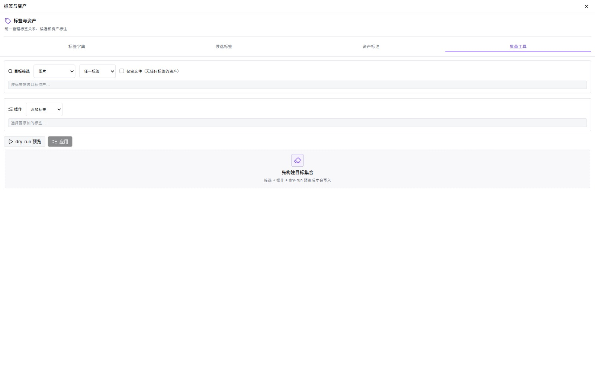

# Grimoire v0.7.3-alpha

> A prompt workbench for AI art and AI chat: tag library, prompt composition, prompt assets, a free multi-panel workspace, and an AI workbench.

**This is an alpha preview.** The core editing path is complete and covered by automated gates; some modules are still under construction — see [Known issues](#known-issues-alpha).


## What it is

A Windows desktop app that puts "find tags → compose a prompt → save the asset → hand it to a model" in one window:

- **Tag library** — 4,589 bilingual tags in a category / subcategory / tag tree, with search, filtering and random draws; multiple switchable tag groups.
- **Prompt workbench** — positive / negative panes, weight editing, dedupe, random pick, undo/redo, one-click copy.
- **Prompt assets** — 1,862 built-in assets from 8 sources, sorted into 9 fixed shelves, with source / history / preset / favorite views, preview and apply.
- **Document workbench** — NovelAI-style block parsing: block names and layout kept apart from the raw text, per-character positive/negative text, seeded random pools, and transactions grouped per user/agent with selective undo.
- **Infinite canvas**, **AI workbench** (providers, models, agent runtimes, permissions, MCP, sessions), **WD14 tagging**, **ComfyUI**, **gallery search**, **embedded browser**.

## Screens

| Settings | Appearance |
|---|---|
|  |  |

| Prompt assets | Tags & assets (batch tools) |
|---|---|
|  |  |

The UI prefers a locally installed **Sarasa UI SC**, falls back to Segoe UI / Microsoft YaHei when absent (the font is **not** bundled), caps every corner at 5px, and uses [Lucide](https://lucide.dev) icons.

## Download

Windows 10 / 11 x64.

| File | What it is |
|---|---|
| `Grimoire.Setup.0.7.3-alpha.exe` | NSIS installer (choose install directory, desktop shortcut) |
| `Grimoire.0.7.3-alpha.exe` | Single-file portable executable |
| `Grimoire-portable-0.7.3-alpha.zip` | Unpacked portable build (fastest start) |
| `SHA256SUMS-0.7.3-alpha.txt` | Checksums for the three files above |

User data lives in `%APPDATA%\Grimoire\grimoire.db`. For a truly portable data directory, place an empty file named `portable` next to `Grimoire.exe`; the database then moves to `data\grimoire.db` beside it.

The installers are unsigned, so SmartScreen shows a warning on first run.

## Run from source

```bash
npm install
npm run build
node scripts/launch-dist.mjs          # serve dist/renderer and launch Electron
```

```powershell
$env:ELECTRON_RUN_AS_NODE = ''        # required on Windows
npm run dev                            # Vite + Electron with HMR
```

`npm start` alone is not enough: an unpackaged build points the window at `http://localhost:5173`.

## License

GNU Affero General Public License v3.0 (AGPL-3.0-only) — see [LICENSE](./LICENSE). Third-party sources and their licenses are listed in [THIRD_PARTY_NOTICES.md](./THIRD_PARTY_NOTICES.md); no font is bundled.

Author: [hanqingyan3293](https://github.com/hanqingyan3293)
