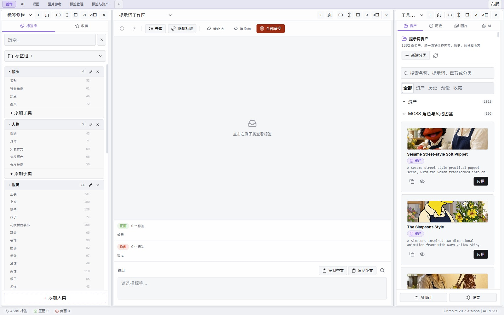
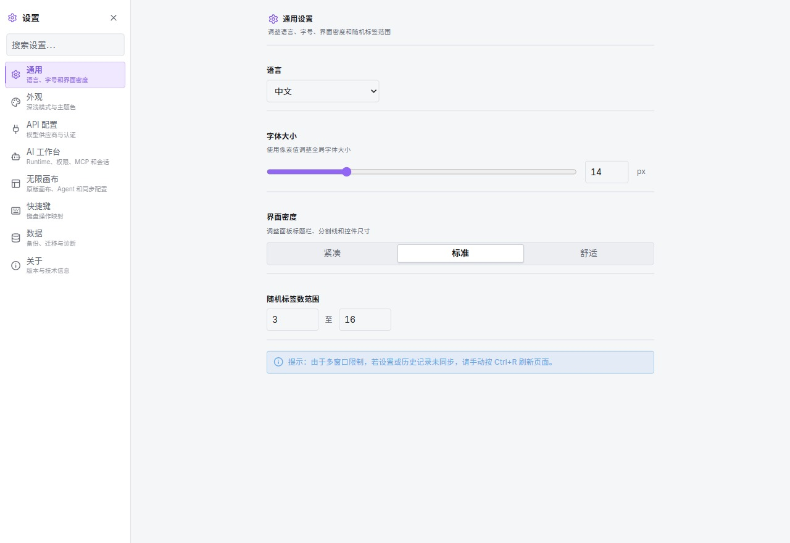
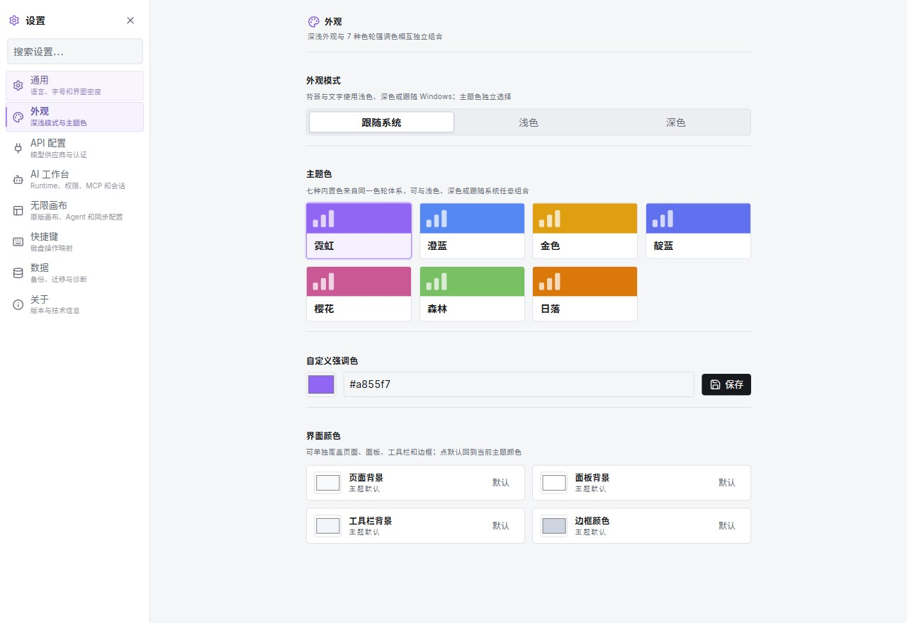

# Grimoire v0.7.3-alpha

> A prompt workbench for AI art and AI chat: tag library, prompt composition, prompt assets, and a free multi-panel workspace.



## What it is

Prompt work for AI art usually looks like this: dig through pages of tag docs, paste a prompt, generate, tweak one word, and next week the only copy left is a line in a chat log. Prompts are not throwaway input — they need to be kept, iterated and reused, but most tools only give you a text box.

Grimoire turns that loop into a desktop workbench, built around three choices:

- **Tag-driven instead of free typing** — 4,589 bilingual tags in a category / subcategory / tag tree with search, filtering and random draws; one click puts a tag into the prompt, and weights, positive/negative and de-duplication are handled for you.
- **Prompts are assets, not drafts** — 1,862 built-in prompt assets from 8 sources, plus your own history, presets and favourites, all categorised, searchable, previewable and one-click appliable.
- **Many panels, not one window** — keep the tag library, prompt workspace, prompt assets, AI assistant and infinite canvas on screen at once; split, tab, or pop panels out, and the layout is restored on restart.

## Capabilities

- **Tag library** — 4,589 bilingual tags in a three-level tree, alias-aware search, favourites, multiple switchable tag groups (import / export / rename / copy), random draws scoped to the current filter.
- **Prompt workspace** — positive / negative panes, per-tag weight, drag to reorder, dedupe, clear, undo / redo, one-click copy in Chinese or English.
- **Document workbench** — block parsing where block names and layout stay separate from the raw text, per-character fidelity (CRLF, surrogate pairs, repeated text), per-character positive/negative text, seeded random pools with explicit errors, and user/agent-grouped transactions with selective Agent undo.
- **Prompt assets** — 1,862 built-in assets sorted into nine shelves (character / style / scene / commerce / poster / UI / infographic / photography / lifestyle), with source, history, preset and favourite views, card preview, copy and apply.
- **Tags & assets** — tag dictionary with aliases, metadata and relations; a candidate queue fed by WD14, prompt parsing and AI vision; asset tagging plus reverse lookup; and batch add / remove / replace behind a dry-run preview.
- **Infinite canvas** — image, prompt and task nodes on a free canvas with revisions, autosave and recovery.
- **AI workbench** — multiple providers (Chat Completions / Responses API), model discovery and connection tests, Pi / OpenCode agent runtimes, three permission modes, MCP servers, sessions and topics.
- **Other panels** — WD14 tagging, ComfyUI workflows and tasks, syntax-based gallery search, embedded browser, task queue.

## Screens

| Settings | Appearance |
|---|---|
|  |  |

| Prompt assets | Tags & assets (with batch tools) |
|---|---|
|  |  |

## Download

Windows 10 / 11 x64. Grab the [latest release](https://github.com/hanqingyan3293/Grimoire-Prompt-Combiner/releases/latest).

| File | What it is |
|---|---|
| `Grimoire.Setup.0.7.3-alpha.exe` | NSIS installer (choose install directory, desktop shortcut) |
| `Grimoire.0.7.3-alpha.exe` | Single-file portable executable |
| `Grimoire-portable-0.7.3-alpha.zip` | Unpacked portable build (fastest start) |
| `SHA256SUMS-0.7.3-alpha.txt` | Checksums for the three files above |

User data lives in `%APPDATA%\Grimoire\grimoire.db`. For a truly portable data directory, place an empty file named `portable` next to `Grimoire.exe`; the database then moves to `data\grimoire.db` beside it. The builds are unsigned, so SmartScreen warns on first run.

## Run from source

```bash
npm install
npm run build
node scripts/launch-dist.mjs          # serve dist/renderer and launch Electron
```

```powershell
$env:ELECTRON_RUN_AS_NODE = ''        # required on Windows
npm run dev                            # Vite + Electron with HMR
```

`npm start` alone is not enough: an unpackaged build points the window at `http://localhost:5173`.

## Stack

Electron 42 · React 19 · TypeScript · Vite 8 · Tailwind CSS v4 · node:sqlite (`DatabaseSync`) · Zustand · electron-builder.

## Known issues

1. **Occasional blank window on first launch** — the Chromium network service can swallow the first navigation. The app retries twice on its own; otherwise press `Ctrl+R`.
2. **AI features need your own keys** — configure providers under Settings → API; nothing is bundled.
3. **Unsigned builds** — SmartScreen will warn once.

This is `0.7.3-alpha`: public surface and some panels are still moving. Please file feedback via [Issues](https://github.com/hanqingyan3293/Grimoire-Prompt-Combiner/issues).

## License

GNU Affero General Public License v3.0 (AGPL-3.0-only) — see [LICENSE](./LICENSE). Third-party sources and their licenses are listed in [THIRD_PARTY_NOTICES.md](./THIRD_PARTY_NOTICES.md).

Author: [hanqingyan3293](https://github.com/hanqingyan3293)
