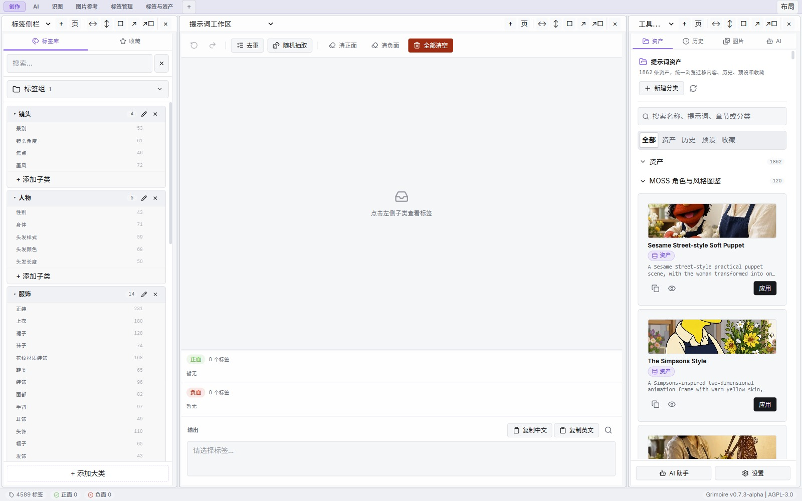
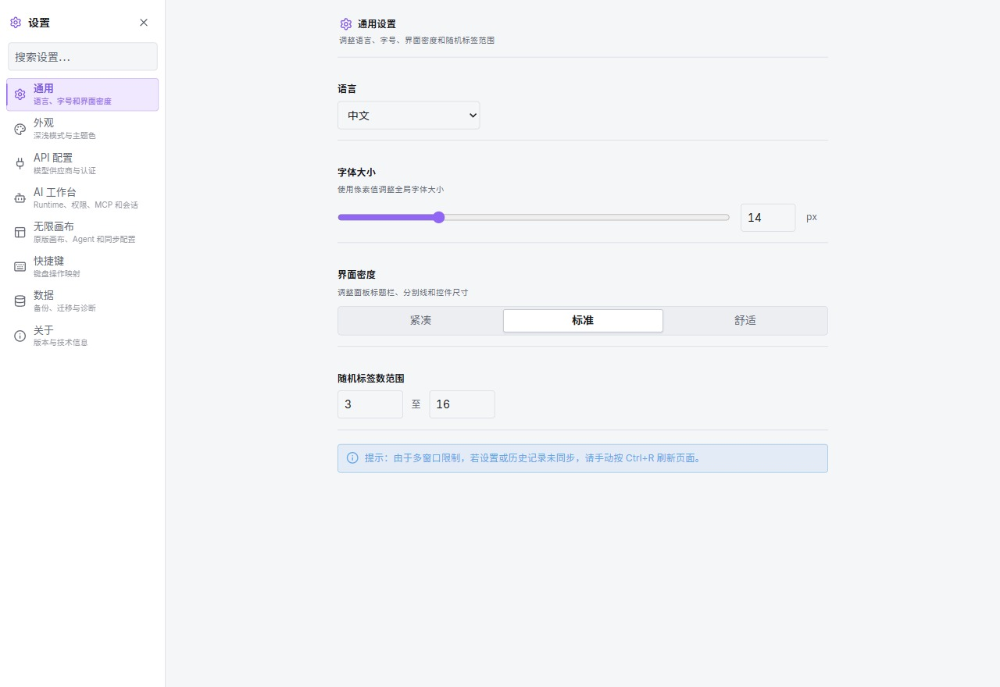
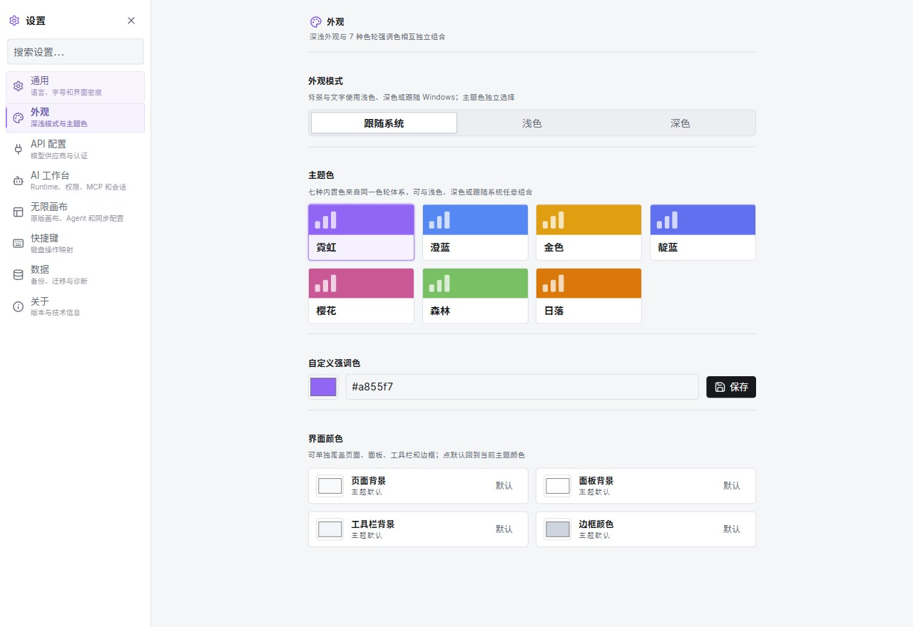
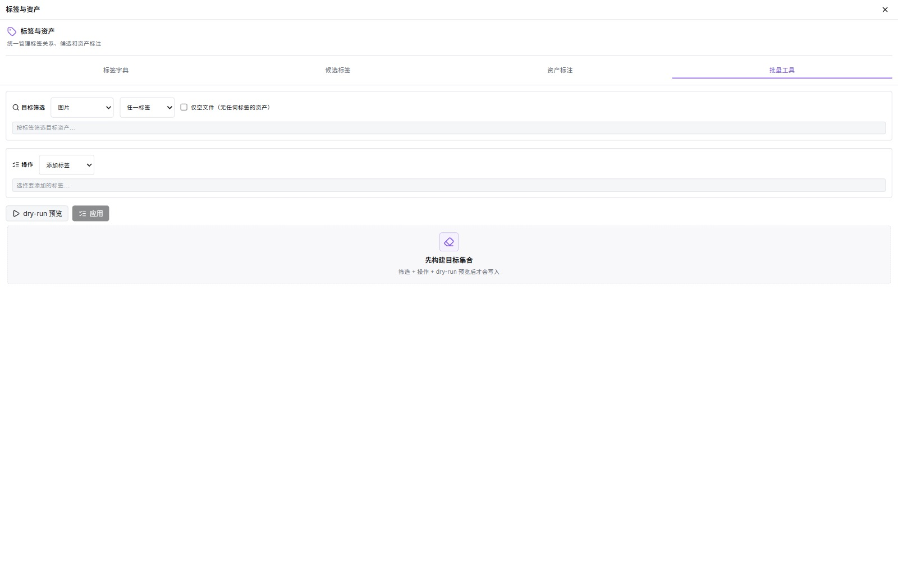

# 魔导书 Grimoire v0.7.3-alpha

> 面向 AI 绘画与 AI 对话的提示词工作台：标签库、提示词组合、提示词资产、自由多面板工作区、AI 工作台。

**这是开发预览版（alpha）。** 核心编辑链路已闭环并通过自动化验收，仍有模块在施工中，见[已知问题](#已知问题alpha)。



## 这是一个什么软件

魔导书 Grimoire 是一个 Windows 桌面应用。它把"查标签 → 组提示词 → 存资产 → 交给模型"这条链路放进一个窗口：

- **标签库**：4589 个中英对照标签，大类 / 子类 / 标签三层树，搜索、筛选、随机抽取，可切换多套标签组。
- **提示词工作区**：正面 / 负面分栏、权重增减、去重、随机抽取、清空、撤销重做，一键复制中英文。
- **提示词资产**：内置 1862 条资产（8 个来源），9 个固定分类货架，支持来源 / 历史 / 预设 / 收藏四种视图，卡片预览与一键应用。
- **提示词工作台**：NovelAI 风格的块解析——块名与布局与原文分离、多角色各自独立正负文本、随机池按 seed 抽样、按 user/agent 分组的事务撤销（可选择只撤 Agent 改动的区域）。
- **无限画布**：图片、提示词、任务节点的自由画布，项目自动保存与恢复。
- **AI 工作台**：多供应商配置、模型发现、Agent Runtime（Pi / OpenCode）、权限策略、MCP 服务、会话与主题。
- **其他面板**：WD14 反推、ComfyUI 工作流、图库搜索、内嵌浏览器、任务队列。

## 界面

| 设置中心 | 外观与主题 |
|---|---|
|  |  |

| 提示词资产 | 标签与资产（含批量工具） |
|---|---|
|  |  |

界面字体优先使用本机已装的**更纱黑体 UI（Sarasa UI SC）**，未安装时回落到 Segoe UI / 微软雅黑；字体不随安装包分发。全站圆角不超过 5px，图标统一使用 [Lucide](https://lucide.dev)。

## 下载与安装

系统要求：**Windows 10 / 11 x64**。

| 文件 | 说明 |
|---|---|
| `Grimoire.Setup.0.7.3-alpha.exe`（约 250 MB） | NSIS 安装版：可选安装目录，创建桌面快捷方式 |
| `Grimoire.0.7.3-alpha.exe`（约 250 MB） | 单文件免安装版：放到任意目录双击运行，适合 U 盘 / 移动硬盘 |
| `Grimoire-portable-0.7.3-alpha.zip`（约 345 MB） | ZIP 便携版：解压后运行目录内的 `Grimoire.exe`（启动最快，不用每次解压） |
| `SHA256SUMS-0.7.3-alpha.txt` | 以上文件的 SHA-256 校验和 |

用户数据默认存放在 `%APPDATA%\Grimoire\grimoire.db`（SQLite）。换版本时保留该文件即可；

> 便携版若想"数据跟着程序走"：在 `Grimoire.exe` 同目录放一个名为 `portable` 的空文件，数据库会改存到同目录 `data\grimoire.db`。

安装包未做代码签名，Windows SmartScreen 首次运行会提示"更多信息 → 仍要运行"。

## 从源码运行

```bash
npm install
npm run build
node scripts/launch-dist.mjs          # 以构建产物启动（推荐）
```

开发模式（Vite 热更新）：

```powershell
$env:ELECTRON_RUN_AS_NODE = ''        # 必须：否则 electron 会以 Node 身份启动并报 requestSingleInstanceLock
npm run dev
```

> 为什么不直接 `npm start`：未打包时主进程会把窗口指向 `http://localhost:5173`，没有 Vite 在跑就是白窗。`scripts/launch-dist.mjs` 会把 `dist/renderer` 起成静态服务再指过去，并自动兜底首启偶发 about:blank。

重新打包：

```bash
npm run build && npx electron-builder --win --x64     # 输出到 release/
```

## 技术栈

| 技术 | 用途 |
|------|------|
| Electron 42 | 桌面应用框架 |
| React 19 + TypeScript | 渲染层 |
| Vite 8 + Tailwind CSS v4 | 构建与样式 |
| node:sqlite (`DatabaseSync`) | 本地数据库（schema 42） |
| Zustand | 状态管理 |
| electron-builder | 打包分发 |

## 项目结构

```text
grimoire/
├── src/
│   ├── main/           # Electron 主进程（服务、IPC、数据库）
│   ├── preload/        # 预加载脚本与 window.api 桥
│   ├── renderer/       # React 渲染层（组件、面板、状态、样式）
│   ├── shared/         # 主进程与渲染层共享的合同与类型
│   ├── integrations/   # 与各来源项目对接的适配层
│   └── vendor/         # 迁移进来的源（只读，见 THIRD_PARTY_NOTICES.md）
├── data/               # 默认标签与提示词资产
├── public/fonts/       # 内置字体（更纱黑体 UI）
├── docs/screenshots/   # README 与发版截图
├── resources/          # 图标、Python worker、Agent runtime
└── release/            # 打包输出
```

## 已知问题（alpha）

1. **首次启动偶发白屏**：Chromium network service 崩溃导致首次导航不提交。按 `Ctrl+R`，或使用 `scripts/launch-dist.mjs`（会自动强制导航）。已记为待修项。
2. **AI 功能需要自备密钥**：所有供应商都由你在「设置 → API 配置」里填写，软件不内置任何 key。
3. **安装包偏大**（约 250 MB）：主要是 Electron 运行时与生产依赖，另加 12 MB 素材。
4. **版本快照 / 自动 checkpoint 未完成**：提示词工作台当前的事务撤销只在内存中，落库版本化属下一阶段。
5. **未签名**：SmartScreen 会拦一次。

## 使用文档

详细操作说明见 [操作文档.md](./操作文档.md)。

## 许可证

本项目采用 **GNU Affero General Public License v3.0（AGPL-3.0-only）**。完整许可证见 [LICENSE](./LICENSE)。

迁移/适配的第三方源码及其许可证（Cherry Studio AGPL-3.0、OpenCode MIT、Pi MIT、Dockview MIT 等）见 [THIRD_PARTY_NOTICES.md](./THIRD_PARTY_NOTICES.md)。

作者：[hanqingyan3293](https://github.com/hanqingyan3293) · 仓库：[Grimoire-Prompt-Combiner](https://github.com/hanqingyan3293/Grimoire-Prompt-Combiner)
